<!-- Every card is an animated SVG drawn by scripts/render_readme_cards.py and refreshed daily by
     .github/workflows/update-readme-cards.yml. Spacing is baked into the SVGs, so keep this block
     free of blank lines and keep each row of cards on one line with no spaces between them. -->

<a href="https://berkeuguraksakal.com"></a> 
 
 
<a href="https://github.com/BUAksakal/ai-vision-robotic-hand"></a><a href="https://github.com/BUAksakal?tab=repositories"></a><a href="https://github.com/BUAksakal/low-altitude-aerial-detection"></a> 
<picture><source media="(prefers-color-scheme: dark)" srcset="./cards/title-dark.svg" /></picture> 
<a href="https://github.com/BUAksakal/low-altitude-aerial-detection"></a><a href="https://github.com/BUAksakal/journey-resilience-agent"></a> 
<a href="https://github.com/BUAksakal/ai-vision-robotic-hand"></a><a href="https://github.com/BUAksakal/space-shooter-spi"></a>

<a href="https://berkeuguraksakal.com">berkeuguraksakal.com</a> &nbsp;/&nbsp; <a href="https://www.linkedin.com/in/berke-ugur-aksakal">linkedin</a> &nbsp;/&nbsp; <a href="https://github.com/BUAksakal?tab=repositories">all repos</a>

